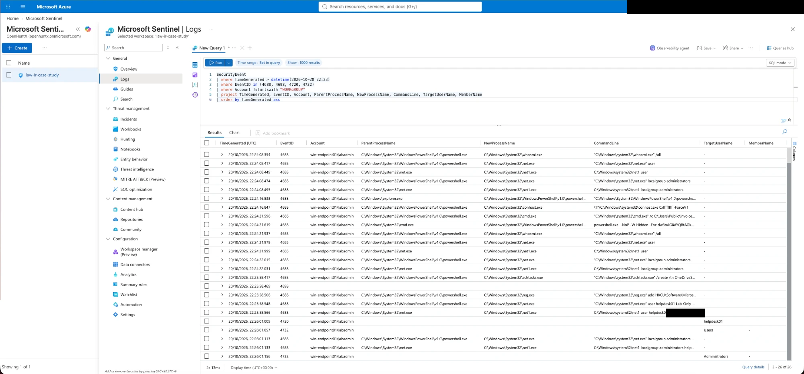
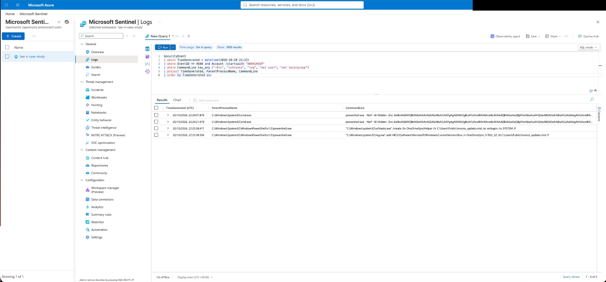
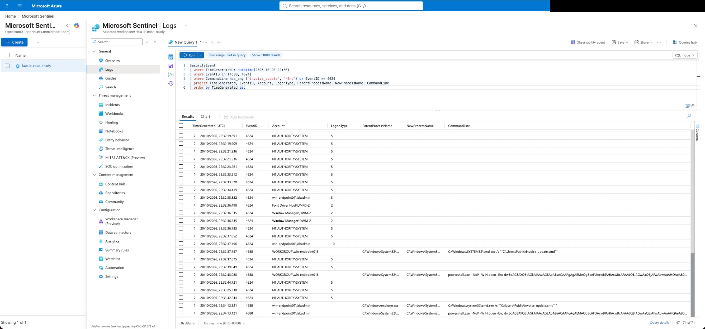
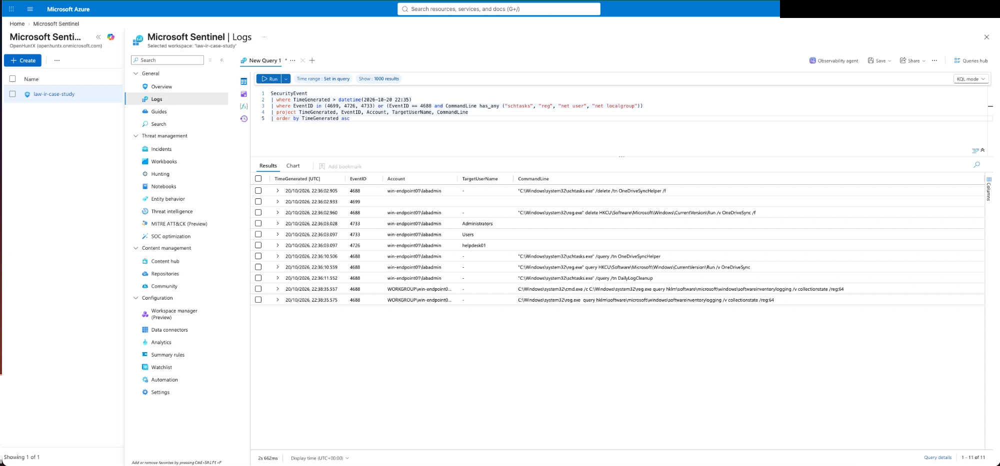
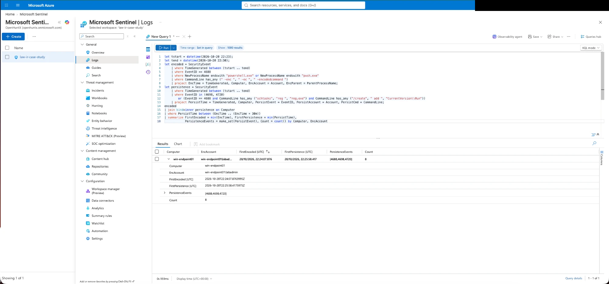

# Case 2: Suspicious endpoint execution with persistence

**Level:** the most hands-on. **Logs used:** Windows Security events from a VM. **Needs:** lab step 1 (workspace and Sentinel) and lab step 4 (the Windows VM). You can skip the Entra steps (2 and 3) for this case.

## The story in two minutes

A script called `invoice_update.cmd` is saved in `C:\Users\Public`, a folder any user on the machine can write to. When it's run, it starts PowerShell with the window hidden and the command **encoded** (a base64 string, so you can't read it at a glance). The hidden command lists the machine's accounts and administrators.

Then the same script is made to run again by itself, three ways:

1. a **scheduled task** called `OneDriveSyncHelper`, run as SYSTEM at every logon (a name chosen to look like OneDrive),
2. a **Run registry value**, so it also starts when the user logs on,
3. a new local administrator called `helpdesk01`.

I restarted the VM to prove it works, and it does: the task ran as SYSTEM half a second after I logged in, and the Run key ran about 95 seconds later. Then I removed everything, checked it was gone, restarted again, and checked that nothing came back.

Nothing alerted while any of this happened. So the improvement from this case is a detection: **encoded PowerShell followed by persistence on the same machine**.

(The payload is harmless. It only lists accounts. The "attacker" is me, on a disposable VM.)

## What you'll learn

- **Process creation events (4688) with the command line are the most useful Windows log you can have.** They're off by default. [This script](../scripts/case2-windows-vm/01-turn-on-logging.ps1) turns them on.
- **What a hidden encoded PowerShell looks like in a log**: `-NoP -W Hidden -Enc <long string>`.
- **How to tell normal from suspicious persistence.** I created a legitimate scheduled task first, as a baseline, so I could compare it with the malicious one: system program, clear name, daily trigger versus a script in a public folder, a name mimicking OneDrive, run at logon.
- **Prove persistence works.** Restart and look.
- **Passwords typed on a command line get logged in plain text.** Mine did.
- **Know your blind spots.** A Run key written by a PowerShell cmdlet instead of `reg.exe` wouldn't have shown up at all in this setup.

## Quick facts

| | |
|---|---|
| Machine | Windows Server 2025 VM `win-endpoint01` (Azure, UK West) |
| Account | `win-endpoint01\labadmin` |
| First execution | 22:24:07 UTC |
| Persistence created | 22:25:58 to 22:26:01 UTC |
| Persistence proved | After a restart: 22:32:37 (task, SYSTEM) and 22:34:12 (Run key, user) |
| Contained | 22:36:02 UTC. Checked after a second restart at 22:37:51: nothing came back |
| Alert | None |
| Detection built | `encoded-powershell-then-persistence.kql` |

## Read it

| File | What it is |
|---|---|
| [`investigation.md`](investigation.md) | The full case |
| [`management-update.md`](management-update.md) | The short version for non-technical readers |
| [`technical-report.md`](technical-report.md) | The version for another analyst |
| [`reproduce.md`](reproduce.md) | How to run this yourself |
| [`queries.kql`](queries.kql) | Every query, in order, with notes |
| [`../scripts/case2-windows-vm/`](../scripts/case2-windows-vm/) | Every PowerShell command, as scripts |
| [`evidence.md`](evidence.md) | All 29 screenshots with captions |
| [`img/`](img/) | The screenshots |

## Five screenshots that tell the story

**The attack timeline** ([`case2-13`](img/case2-13-attack-timeline-4688-4698-4720-4732.png)):

**The full command lines** ([`case2-16`](img/case2-16-key-commandlines.png)):

**The persistence firing after a restart** ([`case2-18`](img/case2-18-persistence-fired-at-logon.png)):

**The cleanup, in the log** ([`case2-22`](img/case2-22-removal-events-4699-4726-4733.png)):

**The detection finds the attack window** ([`case2-24`](img/case2-24-rule-test-a-attack-window.png)):

## Still open

- The script ran **twice**, 14 seconds apart (22:24:07 and 22:24:21), with a PowerShell window opened from Explorer in between. I don't remember why.
- Whether Windows Defender noticed anything. Its log isn't collected here.
- Whether there's other persistence I didn't look for (services, WMI, startup folder).
- Whether a Run key written another way would have shown up at all.
