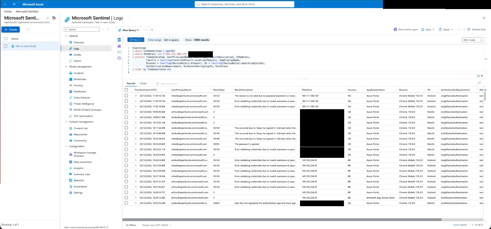
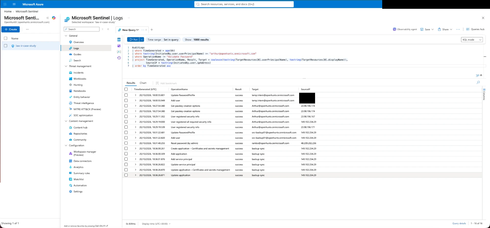
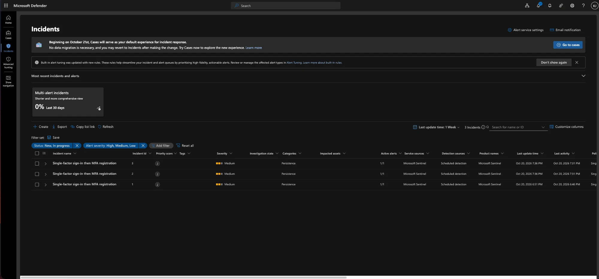
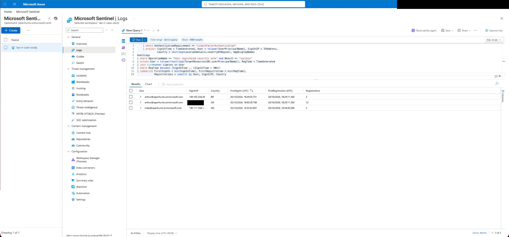
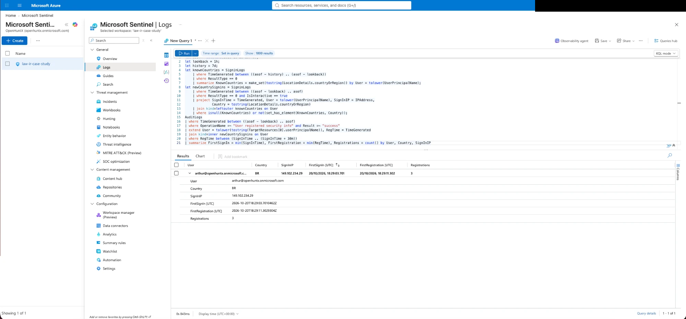

# Case 3: Admin account compromise with identity changes

**Level:** medium. **Logs used:** Entra ID sign-in and audit logs. **Needs:** lab steps 1 to 3.

## The story in two minutes

Arthur is the IT admin. He can create users, reset passwords and register apps. Someone tries two passwords each on three accounts, then signs in as Arthur from Brazil. Arthur's MFA is asked for this time, and gets completed (in the lab, by me).

Then the account starts changing things:

- it adds a new sign-in method for itself (another passkey),
- it creates a new user called `svc-backup01` and gives it the display name `backup-sync`,
- it resets a finance colleague's password,
- it registers an app, also called `backup-sync`, and creates a client secret for it.

A new user, a reset password and an app with a secret are all ways of getting back in later. The question that makes this case interesting: **how do you tell an admin doing a normal job from an attacker using the admin's account?** I recorded a baseline first (Arthur creating a test user from home) so I could compare.

I contained it 38 minutes after the first success (a lab delay, because I waited for logs). I removed the passkey, signed both accounts out everywhere, reset both passwords, deleted the user and the app. Then I tested it from Brazil: old passwords rejected, old sessions rejected.

The detection I'd built for Case 1 fired on this attack. It also fired on Arthur's own home sign-in, so one attack produced two incidents. I fixed it with a better rule that only fires when the sign-in comes from a **new country**. That's the improvement from this case.

## What you'll learn

- **Record a baseline before you attack.** It's what made "normal admin" versus "attacker" visible.
- **Roles change what an account is worth.** Arthur had two admin roles, so one stolen password could create users, reset passwords and register apps.
- **Look for names that copy other things.** The user and the app were both called `backup-sync`.
- **Think about every way back in.** Not just the stolen password: the new method, the new user, the app secret.
- **Test your detection on a second case.** The Case 1 rule looked fine until it saw Case 3.
- **Check who made the change.** 14 "Validate Password" rows looked like guessing. They were the new-user form checking password strength.

## Quick facts

| | |
|---|---|
| Target | `arthur@` (User Administrator and Application Administrator) |
| Attacker | Android phone, VPN exit in Brazil (`149.102.234.29`) |
| Spray | Two wrong passwords each on `rambo@`, `mike@` and `arthur@`, 18:26:53 to 18:27:45 UTC |
| Compromise | Arthur signs in at 18:29:03; MFA step at 18:29:12 |
| Changes made | New passkey, user `svc-backup01` (18:31:22), Rambo's password reset (18:31:40), app `backup-sync` and secret (18:36:00 to 18:36:26) |
| Used afterwards? | No sign-in by the new user or app was seen |
| Contained | 19:07:40 to 19:10:10 UTC |
| Detection | `new-country-signin-then-mfa-registration-v2.kql` |

## Read it

| File | What it is |
|---|---|
| [`investigation.md`](investigation.md) | The full case |
| [`management-update.md`](management-update.md) | The short version for non-technical readers |
| [`technical-report.md`](technical-report.md) | The version for another analyst |
| [`reproduce.md`](reproduce.md) | How to run this attack yourself |
| [`queries.kql`](queries.kql) | Every query, in order, with notes |
| [`evidence.md`](evidence.md) | All 30 screenshots with captions |
| [`img/`](img/) | The screenshots |

## Five screenshots that tell the story

**The attack, from Brazil: failures, then a success on the admin** ([`case3-07`](img/case3-07-foreign-signins.png)):

**What the admin account did** ([`case3-11`](img/case3-11-arthur-audit-no-noise.png)):

**The three incidents from my first rule** ([`case3-13`](img/case3-13-incidents-list.png)):

**The false positive, found by running the rule on 24 hours of data** ([`case3-17`](img/case3-17-rule-v1-three-rows.png)):

**The fix: only the Brazilian sign-in remains** ([`case3-18`](img/case3-18-rule-v2-test-arthur.png)):

## Still open

- Which MFA method completed the 18:29:12 sign-in? I didn't read it.
- Anything the session did beyond directory changes: Graph activity and Azure Activity weren't available.
- Whether the new user or the app secret was used elsewhere.
- What the `23.98.196.x` and `48.209.202.236` addresses on some audit events are (I think Microsoft-side, not verified).
